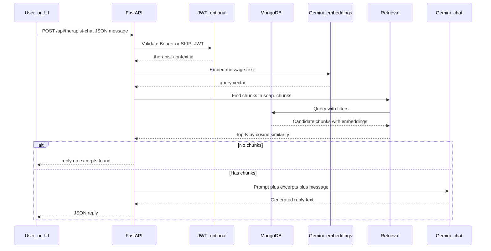

# Therapist SOAP Assistant — API, flow, and technology

This document describes the HTTP API, the request-to-response pipeline (RAG), interactive docs (Swagger), and the main technologies used.

---

## Interactive API documentation (Swagger)

When the server is running:

| URL | Description |
|-----|-------------|
| **`/docs`** | Swagger UI — try endpoints, schemas, **Authorize** with Bearer JWT |
| **`/redoc`** | ReDoc — alternate layout |
| **`/openapi.json`** | OpenAPI 3.x machine-readable schema (same source as Swagger) |

**Base URL example:** `http://127.0.0.1:8001` (your host/port may differ).

Swagger stays in sync with the code: models and routes are generated from FastAPI/Pydantic. After you change endpoints, restart the server and refresh `/docs`.

---

## HTTP endpoints (summary)

| Method | Path | Auth | Purpose |
|--------|------|------|---------|
| `GET` | `/` | No | Small HTML landing page with links |
| `GET` | `/health` | No | Liveness: `{"status":"ok"}` |
| `GET` | `/chat` | No | Serves `frontend/therapist-chat.html` (chat demo UI) |
| `GET` | `/ui/therapist-chat.html` | No | Same HTML as `/chat` |
| `POST` | `/api/therapist-chat` | Bearer JWT¹ | Main chat (RAG) |
| `POST` | `/api/v1/chat` | Bearer JWT¹ | Same behavior as `/api/therapist-chat` |
| — | `/docs`, `/redoc`, `/openapi.json` | No | API documentation |

¹ If `SKIP_THERAPIST_JWT=true` in `.env`, JWT is not required (local testing only).

---

## Chat API (detail)

### `POST /api/therapist-chat` and `POST /api/v1/chat`

**Headers**

- `Content-Type: application/json`
- `Authorization: Bearer <JWT>` — unless `SKIP_THERAPIST_JWT=true`

**Body (JSON)**

| Field | Type | Required | Description |
|-------|------|----------|-------------|
| `message` | string | Yes | User question (1–8000 chars). Used for embedding + retrieval + generation. |
| `patient_id` | string \| null | No | If set, restricts search to chunks with this `patientId`. |
| `session_id` | string \| null | No | If set, restricts search to chunks with this `sessionId`. |

**Response (JSON)**

| Field | Type | Description |
|-------|------|-------------|
| `reply` | string | Final answer from Gemini, guided by prompts in `app/rag/llm.py` (greetings allowed; off-topic non-clinical questions refused; clinical answers grounded in retrieved excerpts). |

**Errors (examples)**

- `401` — Missing/invalid JWT (when JWT is required).
- `429` — Gemini quota / rate limit on `generateContent` (see response `detail`).
- `502` — Other Gemini API errors.

**Rate limiting**

- SlowAPI: configurable via `RATE_LIMIT_PER_MINUTE` (see `.env.example`).

---

## End-to-end flow: from user question to `reply`

**Step-by-step (what the code does)**

1. **HTTP** — FastAPI receives `POST /api/therapist-chat` with `ChatRequest` body.
2. **Auth** (`app/auth.py`) — If `SKIP_THERAPIST_JWT` is false, validates `Authorization: Bearer` with `JWT_SECRET` (HS256). Extracts a therapist id from claims (`sub`, `therapistId`, `userId`, `id`). If skip-auth is true, uses a placeholder id for logging only (retrieval scope still depends on `RAG_THERAPIST_SCOPED`).
3. **Rate limit** — SlowAPI may reject excess requests per IP.
4. **Embed query** (`app/rag/embeddings.py`) — Calls Gemini **embedding** model (e.g. `gemini-embedding-004` / `gemini-embedding-001` per `.env`) to turn `message` into a vector.
5. **Retrieve** (`app/rag/retrieve.py`) — Reads from MongoDB collection `SOAP_CHUNKS_COLLECTION` (default `soap_chunks`). Filters by optional `patient_id`, `session_id`, and **optionally** `therapistId` when `RAG_THERAPIST_SCOPED=true`. Loads candidate documents with `embedding` and ranks by **cosine similarity** to the query vector; returns top **K** (`RAG_TOP_K`).
6. **No chunks** — Returns a fixed `reply` string asking to index data / rephrase (no call to chat model).
7. **Generate** (`app/rag/llm.py`) — Builds a prompt with SOAP excerpts + user message. Calls Gemini **`generateContent`** (`GEMINI_CHAT_MODEL`, e.g. `gemini-2.0-flash`). Handles `429` / other API errors as HTTP errors where applicable.
8. **Response** — Returns `ChatResponse` with `{ "reply": "..." }`.

**Indexing (offline / batch)** — Full SOAP documents are not read at chat time from raw collections unless already chunked. Use `python -m scripts.backfill_chunks` to populate `soap_chunks` from `SOAP_SOURCE_COLLECTION` (see `SCHEMA.md`).

---

## Technology stack

| Layer | Technology | Role |
|-------|------------|------|
| Language | Python 3.10+ | Service implementation |
| Web framework | **FastAPI** | REST API, OpenAPI/Swagger, validation (Pydantic) |
| ASGI server | **Uvicorn** | Runs the app (`uvicorn app.main:app`) |
| Database | **MongoDB** | Stores `soap_chunks` (text + embeddings + ids) |
| DB driver | **Motor** | Async MongoDB access |
| Config | **Pydantic Settings** | Loads `.env` |
| Auth | **PyJWT** | HS256 Bearer tokens (aligned with Express) |
| LLM / embeddings | **Google Gemini API** via **`google-genai`** | `embed_content` + `generate_content` |
| Rate limiting | **slowapi** | Per-IP limits on chat routes |
| CORS | **Starlette** (via FastAPI) | `CORS_ORIGINS` for browser clients |
| Frontend demo | Static HTML | `frontend/therapist-chat.html`; served at `/chat` |

**Related files**

- `app/main.py` — App factory, CORS, routes for `/`, `/health`, `/chat`, mounts OpenAPI.
- `app/routes/chat.py` — Chat endpoints and request/response models.
- `app/rag/*` — Chunking (ingest), embeddings, retrieval, LLM prompts.
- `scripts/backfill_chunks.py` — Builds/updates `soap_chunks` from source Mongo collections.

---

## Configuration (environment)

See **[`.env.example`](../.env.example)** for:

- `MONGODB_URI`, `MONGODB_DB_NAME`, collection names  
- `JWT_SECRET`, `SKIP_THERAPIST_JWT`, `DEV_THERAPIST_ID`  
- `GEMINI_API_KEY` / `GOOGLE_API_KEY`, `GEMINI_CHAT_MODEL`, `EMBEDDING_MODEL`  
- `RAG_TOP_K`, `RAG_MAX_CHUNKS_FETCH`, `RAG_THERAPIST_SCOPED`  
- `CORS_ORIGINS`, `RATE_LIMIT_PER_MINUTE`  

---

## Further reading

- **[SCHEMA.md](../SCHEMA.md)** — MongoDB chunk shape and JWT notes  
- **[README.md](../README.md)** — Run commands and quick start  
